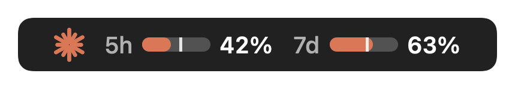
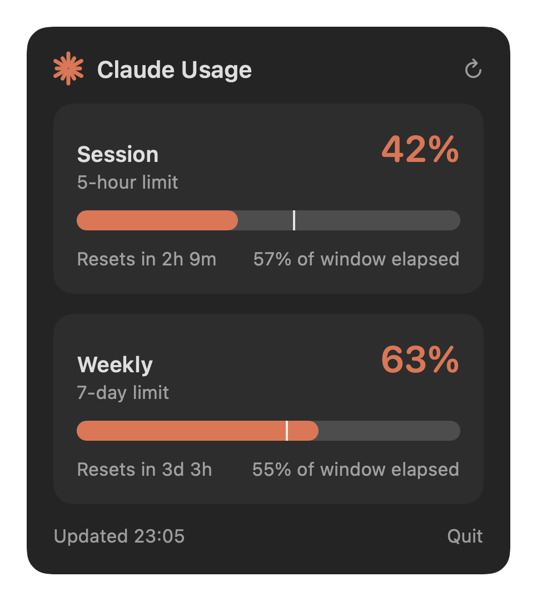
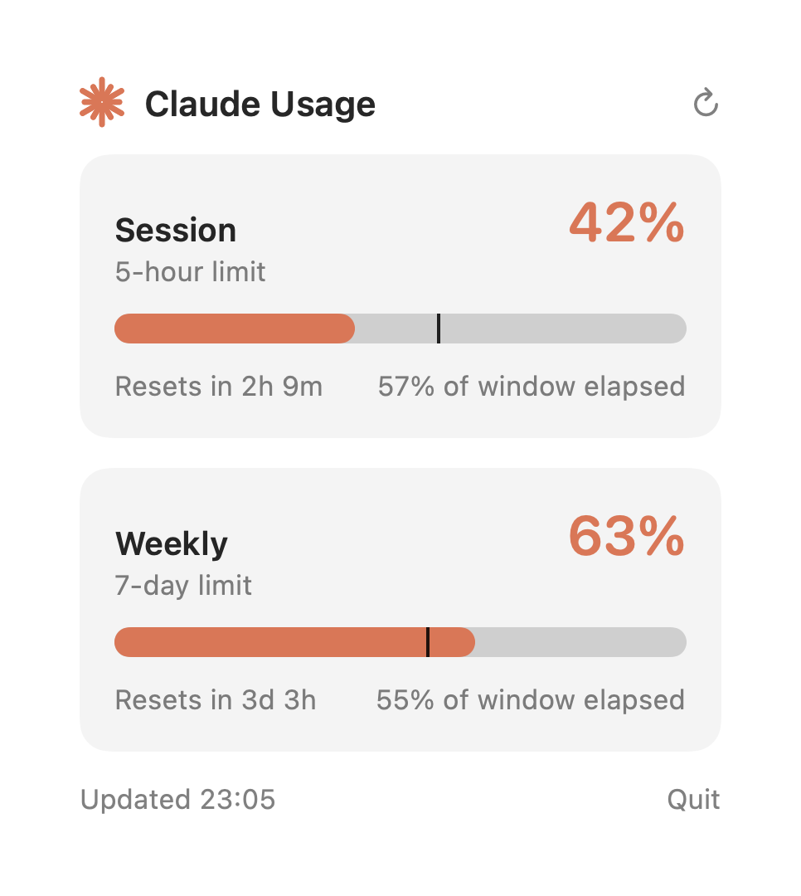
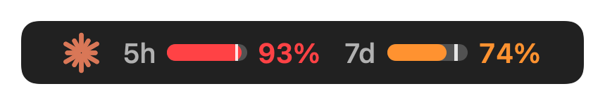

<div align="center">

# Claude Usage Bar

**Your Claude 5-hour and weekly limits, always visible in the macOS menu bar.**



</div>

<br>

Stop guessing how much of your Claude quota is left. Claude Usage Bar sits in your menu bar and shows both limits at a glance, with a progress bar for each and a marker for how far through the time window you are. Click it for the full breakdown.

## Features

- **Both limits, always visible.** The 5-hour session limit and the 7-day weekly limit sit side by side in the menu bar.
- **Pace marker.** The thin tick on each bar shows how much of the time window has elapsed. If the fill is ahead of the tick, you're burning through your quota faster than time is passing.
- **Colour-coded warnings.** Bars turn orange at 70% and red at 90%.
- **Details on click.** The popover shows exact percentages, reset countdowns and window progress.
- **Light and dark mode.** It follows the menu bar appearance and updates live when it changes.
- **Lightweight.** A single native Swift app with no dependencies. It polls once a minute and has no Dock icon.

<div align="center">

| Dark | Light |
| :---: | :---: |
|  |  |

</div>

### Reading the bars

<div align="center">

</div>

| Element | Meaning |
| --- | --- |
| Filled bar | Share of the limit you've used |
| White tick | How far through the time window you are |
| Orange / red | 70%+ / 90%+ used |
| `5h` / `7d` | Rolling session limit / weekly limit |

When no 5-hour window is active (you haven't used Claude recently), the 5h bar shows 0% with no tick.

## Requirements

- macOS 13 or later
- Swift 5.9+ toolchain (Xcode or the Command Line Tools)
- A Claude subscription, signed in through [Claude Code](https://claude.com/claude-code) on the same Mac

## Install

```sh
git clone https://github.com/kuttim/claude-usage-bar.git
cd claude-usage-bar
swift build -c release
.build/release/ClaudeUsageBar
```

The first launch asks for access to the `Claude Code-credentials` Keychain item. Choose **Always Allow** so it doesn't ask again.

To start it at login, add the built binary under **System Settings → General → Login Items**.

## How it works

Claude Code stores its OAuth login in your macOS Keychain. Claude Usage Bar reads the access token from there and asks Anthropic's usage endpoint, `GET https://api.anthropic.com/api/oauth/usage`, for your current utilisation and reset times. It refreshes every 60 seconds, or when you press the refresh button.

- The token is read from the Keychain at request time. It is never written to disk and never logged.
- The only network traffic is the request to `api.anthropic.com`.
- If the request fails, for example because you're signed out, the menu bar shows a warning and the popover shows the reason.

> **Heads up:** this endpoint is undocumented and not a supported public API. Anthropic may change or remove it without notice, which would break the app until it's updated.

## Project layout

```
Sources/ClaudeUsageBar/
├── main.swift          App lifecycle, status item, popover, refresh timer
├── Usage.swift         Keychain token lookup and usage API client
├── MenuBarView.swift   Menu bar bars rendered to an image
├── PopoverView.swift   Click-open detail card
├── ClaudeMark.swift    Starburst logo, drawn as a vector shape
└── Screenshots.swift   Generates the images in docs/
```

To regenerate the screenshots in this README, which use sample data:

```sh
.build/release/ClaudeUsageBar --render docs
```

## Notes

- The starburst is a hand-drawn approximation, not the official Claude logo.
- This is an unofficial community project and is not affiliated with or endorsed by Anthropic.
